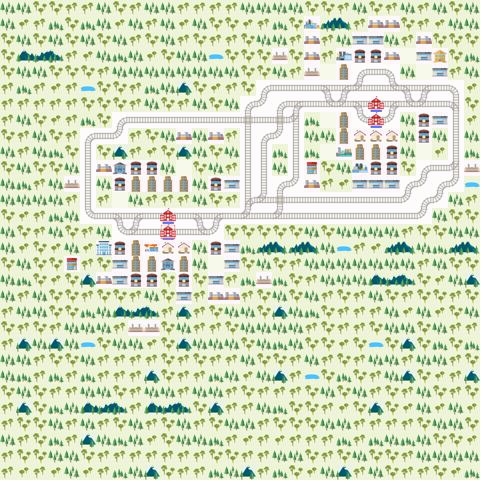
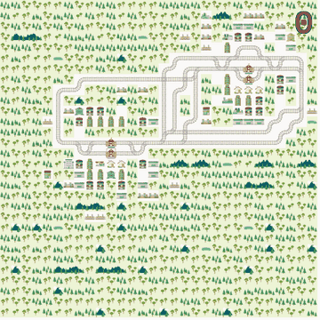

---
hide:
  - navigation
---

# Examples

All commands on this page are run with your flaspland environment activated
(see [Getting started](../getting_started.md)), in the folder you work in.

## Running the sample solution

The toolkit ships with a small environment, `envs/pkl/test.pkl`, and a
hand-written solution for it, `test.lp`, in its `examples` folder.

```console
cd flaspland-toolkit/examples
flaspland solve envs/pkl/test.pkl test.lp
```

<div class="grid" markdown>

{ width="320" }

{ width="320" }

</div>

The environment has two trains. Train 0 starts at `(13,10)` heading east and has
to reach `(7,23)`; train 1 goes the opposite way. Their start and end points are
in `envs/lp/test.lp`:

```prolog
train(0). speed(0,1).
start(0,(13,10),0,e).
end(0,(7,23),33).

train(1). speed(1,1).
start(1,(6,23),1,w).
end(1,(14,10),34).
```

The solution is simply a list of `action/3` atoms, one per train and time step:

```prolog
action(train(0),wait,0).          % initial wait action
action(train(0),move_forward,1).  % spawn into the environment
action(train(0),move_forward,2).  % begin moving forward
...
action(train(0),move_left,9).     % follow the switch to the left
```

Your encodings have to produce atoms of exactly this form. The run writes
`output/<date>_<time>/paths.csv`, which shows what happened at every step:

```text
agent;timestep;position;direction;status;given_command
0;0;None;e;waiting;wait
1;0;None;w;waiting;wait
0;1;None;e;ready to depart;move_forward
1;1;None;w;ready to depart;move_forward
0;2;(13, 10);e;moving;move_forward
1;2;(6, 23);w;moving;move_forward
```

`position` is `None` while a train is not on the map yet (or has already been
removed at its target).

!!! tip
    Add `--no-render` to skip the animation. Runs are much faster, and
    `paths.csv` is still written.

## Generating environments

`flaspland build` creates new environments in the `envs` folder of the current
folder:

```console
flaspland build
```

```text
note: no config.toml in this folder, using built-in defaults
[env_001--2_2] saved (seed=None)
```

Each environment is saved three times under the same name,
`env_<number>--<trains>_<cities>`:

| File | Used by |
| --- | --- |
| `envs/lp/env_001--2_2.lp` | your encoding: the environment as clingo facts |
| `envs/pkl/env_001--2_2.pkl` | `flaspland solve`: the full Flatland environment |
| `envs/png/env_001--2_2.png` | you: a picture of the network |

Numbers continue from the highest existing one, so earlier environments are
never overwritten.

Any setting can be changed for a single run with a flag. For example, five
environments with four trains, three cities and one intermediate stop per
train:

```console
flaspland build 5 --agents 4 --cities 3 --line-length 3
```

Use `--seed` to get the same environments every time, for example to share a
benchmark with others:

```console
flaspland build 10 --seed 42
```

To change the settings permanently, create a `config.toml` and edit it.
`flaspland build` uses it automatically whenever it is run in that folder:

```console
flaspland init
```

To keep several sets of settings, copy `config.toml`, edit the copy, and pass
it with `--config`:

```console
flaspland build 10 --config hard.toml
```

All options are listed in the [command line reference](../reference/api/index.md#buildpy).

## Organising encodings with `#include`

`flaspland solve` takes any number of `.lp` files after the environment and
loads them all into clingo as one program:

```console
flaspland solve envs/pkl/env_001--2_2.pkl encodings/paths.lp encodings/timing.lp
```

Typing every file each time is error-prone. Instead, create one main file that
includes the parts you want to use together:

```prolog title="encodings/main.lp"
#include "paths.lp".
#include "timing.lp".
#include "collisions.lp".
```

and pass only that file:

```console
flaspland solve envs/pkl/env_001--2_2.pkl encodings/main.lp
```

Paths in `#include` are relative to the file that contains them, so
`main.lp` can be called from any folder. This makes it easy to keep several
variants side by side, for example `main-simple.lp` and `main-optimised.lp`,
and always know which files belong together.

!!! note
    Do not include the environment's `.lp` file yourself. `flaspland solve` adds
    the environment facts automatically, from the `.pkl` you pass.

## Optimisation and time limits

With optimisation statements (`#minimize` or weak constraints) clingo reports
better and better plans until it has found the best one, and `flaspland solve`
simulates that last, optimal plan. It tells you which model it used:

```text
flaspland: using model 3 with cost [1] (optimal)
```

Finding the optimum can take long. Use `--time-limit` to stop clingo after a
number of seconds and simulate the best plan found so far:

```console
flaspland solve envs/pkl/env_001--2_2.pkl encodings/main.lp --time-limit 60
```

```text
flaspland: clingo was stopped (solving stopped by signal)
flaspland: using model 93 with cost [626] (optimality not proven)
```

Any other clingo option can be given after `--`. For example, to use four
threads, or to stop at the first plan clingo finds:

```console
flaspland solve envs/pkl/env_001--2_2.pkl encodings/main.lp -- --parallel-mode=4
flaspland solve envs/pkl/env_001--2_2.pkl encodings/main.lp -- --models=1
```

## Malfunctions and replanning

Trains can break down. Generate environments with malfunctions by giving a
malfunction rate (the chance per train and step):

```console
flaspland build --malfunction-rate 0.05 --min-duration 2 --max-duration 5
```

When a train breaks down during the simulation, `flaspland solve` calls your encodings
again with extra facts describing the situation: the actions already executed,
the broken train, and the rest of the previous plan. Your encoding then has to
produce a new plan that keeps the past fixed and lets the broken train wait
until it is repaired. The facts are described in the
[problem specification](../reference/problem/index.md#replanning-after-a-malfunction).

If your encoding finds no plan at this point, `flaspland solve` stops with:

```text
No plan found while replanning after a malfunction: see the clingo output above (e.g. UNSATISFIABLE, or an error in an encoding).
```

This usually means the encoding forces actions that contradict the waits of the
broken train. A fixed list of actions such as `test.lp` cannot react to
malfunctions, so it only works on environments without them.
