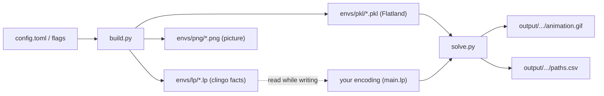

---
hide:
  - navigation
  - toc
---

# flaspland

*flaspland* is a toolkit for solving [Flatland](https://flatland.aicrowd.com)
railway scheduling problems with answer set programming (ASP) and
[clingo](https://potassco.org/clingo/).

You generate railway environments, write an ASP encoding that tells every train
what to do at every time step, and then watch your plan run in the Flatland
simulator. If a train breaks down along the way, your encoding is called again
to repair the plan.

<figure markdown="span">
  { width="360" }
  <figcaption>The sample solution <code>test.lp</code> running on <code>test.pkl</code>.</figcaption>
</figure>

## How it fits together

1. **`build.py`** creates environments and saves each one three ways: as clingo
   facts (`.lp`), as a Flatland object (`.pkl`) and as an image (`.png`).
2. **Your encoding** reads the facts and produces `action/3` atoms, a plan for
   every train.
3. **`solve.py`** loads the `.pkl`, asks clingo for a plan using your encoding,
   runs it in Flatland, replans on malfunctions, and saves an animation and a
   log.

## Where to go next

- [Getting started](getting_started.md): install everything with one command
  and run the sample solution.
- [Examples](examples/index.md): generate environments, organise encodings and
  deal with malfunctions.
- [Problem specification](reference/problem/index.md): the input facts your
  encoding receives and the output it has to produce.
- [Help](community/help.md): solutions to common errors.

!!! info
    *flaspland* is part of the [Potassco](https://potassco.org) suite.
